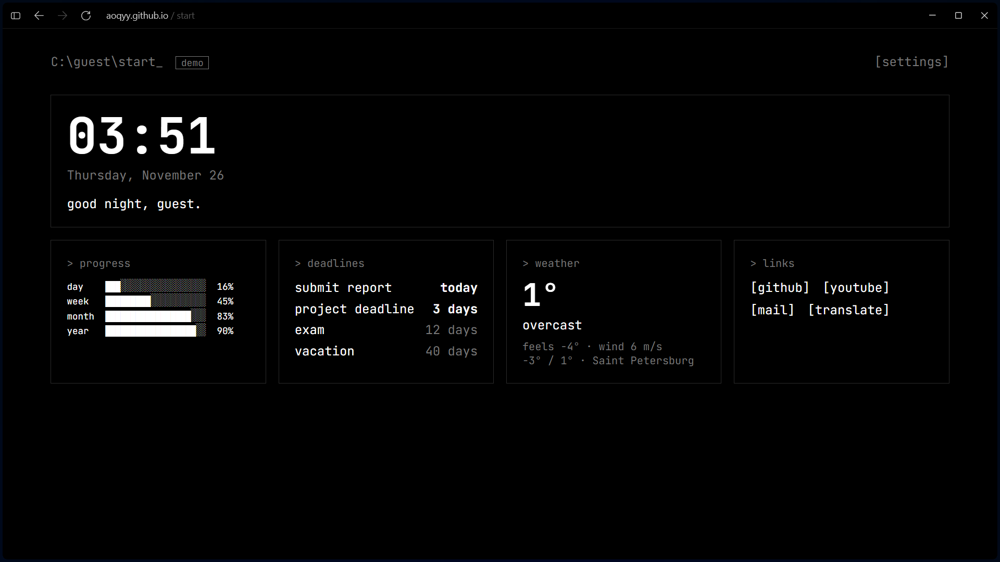

# start

Web browser homepage, keeps everything essential in one place, saves data locally.

# start

A minimal terminal-style start page for your browser.
Clock, progress, deadlines, weather and links in one place. No accounts, no server, your data never leaves your browser.

**[→ live demo](https://aoqyy.github.io/start/)**



## Features

- **clock**: time, date and a greeting for the time of day
- **progress**: how much of the day, week, month and year has passed
- **deadlines**: sorted by date with a countdown, urgent ones highlighted
- **weather**: current weather for any city via [Open-Meteo](https://open-meteo.com), cached for 30 minutes, works offline with the last known data
- **links**: your quick links in one row
- **settings**: edit everything right on the page, export / import a JSON backup
- dark and light theme follow your system

## Privacy

Everything you enter is stored in your browser's `localStorage`.
The repository only contains code and demo data, so anyone opening the page sees the demo until they add their own data.
Use `[export]` to back up your data or move it to another browser.

## Usage

1. Open the [live demo](https://aoqyy.github.io/start/) and click `[settings]`
2. Add your name, city, deadlines (`2026-12-25 | exam`) and links (`github | github.com`)
3. Set the page as your browser's home / startup page

Or run it locally: clone the repo and open `index.html`. No build step, no dependencies.

## Structure

```
index.html        page layout and settings dialog
style.css         all styles
data.example.js   demo data
storage.js        load / save to localStorage
settings.js       settings dialog, export / import
app.js            starts widgets and the update loop
widgets/          one file per widget
```

## Roadmap

- [ ] search bar with prefixes (`g`, `gh`, `yt`)
- [ ] scratch note
- [ ] GitHub contributions
- [ ] toggle and reorder widgets
- [ ] browser extension for the new tab page

## Credits

Weather by [Open-Meteo](https://open-meteo.com) · font [JetBrains Mono](https://www.jetbrains.com/lp/mono/)
