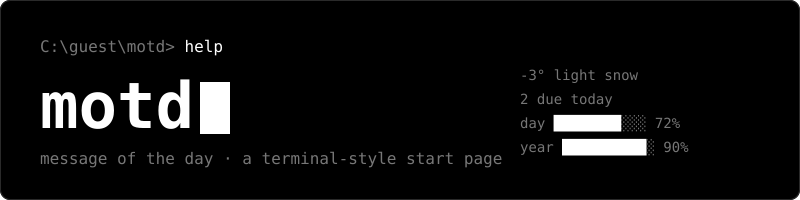
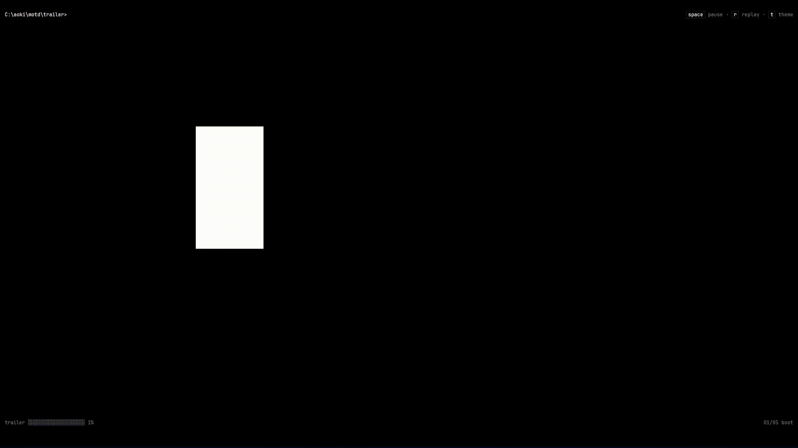

<p align="center">
  
</p>

<p align="center">
  <a href="https://aoqyy.github.io/motd/"></a>
  <a href="https://github.com/aoqyy/motd/releases/latest"></a>
  <a href="LICENSE"></a>
  
  
  
  <a href="https://github.com/aoqyy/motd/commits/main"></a>
</p>

<p align="center">
  <a href="#terminal">Terminal</a> ·
  <a href="#widgets">Widgets</a> ·
  <a href="#privacy">Privacy</a> ·
  <a href="#usage">Usage</a> ·
  <a href="#roadmap">Roadmap</a>
</p>

**m**essage **o**f **t**he **d**ay: a minimal terminal-style start page for your browser.
Type commands, search anything, keep your deadlines, weather, links and GitHub activity in one place.
No accounts, no server, no analytics: your data is stored locally in your browser.

**[→ live demo](https://aoqyy.github.io/motd/)**



## Terminal

The header is a real command line. Just start typing, the page is focused on it from the start.

```
C:\aoki\motd> yt lofi hip hop
```

| command                                                   | what it does                                               |
| --------------------------------------------------------- | ---------------------------------------------------------- |
| `g` `gh` `yt` `w` `r` `ani` + query                       | search Google, GitHub, YouTube, Wikipedia, Reddit, AniList |
| `github`                                                  | open a saved link by its name                              |
| `example.com`                                             | open a url                                                 |
| anything else                                             | search Google                                              |
| `add 2026-12-25 exam` / `add +3 report`                   | add a deadline by date or in N days                        |
| `done exam`                                               | remove a deadline, part of the title is enough             |
| `undo`                                                    | bring back the last deadline removed with `done`           |
| `prefix` · `prefix add so <url with %s>` · `prefix rm so` | list, add or remove your own search prefixes               |
| `activity aoqyy`                                          | show the GitHub contribution grid for a user               |
| `weather tokyo`                                           | change the city                                            |
| `name aoki`                                               | change your name                                           |
| `settings` · `help` · `clear`                             | open settings · show help · clear output                   |

- dim inline suggestions from your history and commands, accept with `Tab` or `→`
- `↑` `↓` to walk through history
- `Ctrl+Enter` opens the result in a new tab, `Esc` clears the line
- press any key anywhere on the page to jump back to the terminal
- custom prefixes can override built-in ones, e.g. `prefix add g https://duckduckgo.com/?q=%s`

## Widgets

- **clock**: time, date, a greeting for the time of day and a short summary: weather, what's due today, next deadline
- **progress**: how much of the day, week, month and year has passed
- **deadlines**: sorted by date with a countdown, urgent ones highlighted, overdue struck through
- **weather**: any city via [Open-Meteo](https://open-meteo.com), cached for 30 minutes, works offline with the last known data
- **links**: your quick links in one row, as `[github]` or `{github}`
- **activity**: your GitHub contribution grid for the last year, cached for an hour

Plus a **settings** dialog to edit everything at once, with export / import of a JSON backup.
Dark and light theme follow your system.

## Privacy

Everything you enter is stored only in your browser's `localStorage`. There are no accounts, no server and no analytics.
The page talks to these services and nothing else:

- [Open-Meteo](https://open-meteo.com): the city name you set (to find its coordinates) and those coordinates (for the forecast)
- [github-contributions-api](https://github.com/grubersjoe/github-contributions-api): the GitHub username you set for the activity grid
- [Google Fonts](https://fonts.google.com): loads the JetBrains Mono font
- whatever search engine or site you open from the terminal

The repository only contains code and demo data, so anyone opening the page sees the demo until they add their own data.
Use `[export]` in settings to back up your data or move it to another browser.
Imported backups are validated: unknown fields are dropped and only `http(s)` links and prefixes are accepted.

## Usage

1. Open the [live demo](https://aoqyy.github.io/motd/)
2. Type `name <your name>`, `weather <your city>`, `activity <github username>` and `add +3 something`, or click `[settings]` to fill everything at once
3. Set the page as your browser's home / startup page, or pin it as a tab

Or run it locally: clone the repo and open `index.html`. No build step, no dependencies.

## Structure

```
index.html        page layout, terminal and settings dialog
style.css         all styles
data.example.js   defaults and demo data
storage.js        load / save to localStorage
settings.js       settings dialog, export / import
terminal.js       command line: commands, search, prefixes, history, suggestions
app.js            starts widgets and the update loop
widgets/          one file per widget
docs/             banner and screenshot for this readme
```

## Roadmap

- [x] terminal with search prefixes, history and suggestions
- [x] custom search prefixes
- [x] GitHub contributions
- [ ] scratch note
- [ ] toggle and reorder widgets
- [ ] typing effect for the greeting

## Credits

Weather by [Open-Meteo](https://open-meteo.com) · contributions by [github-contributions-api](https://github.com/grubersjoe/github-contributions-api) · font [JetBrains Mono](https://www.jetbrains.com/lp/mono/) · badges by [shields.io](https://shields.io)

## License

[MIT](LICENSE)
